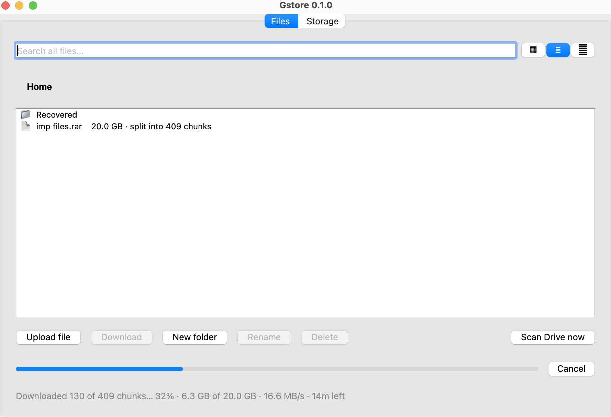
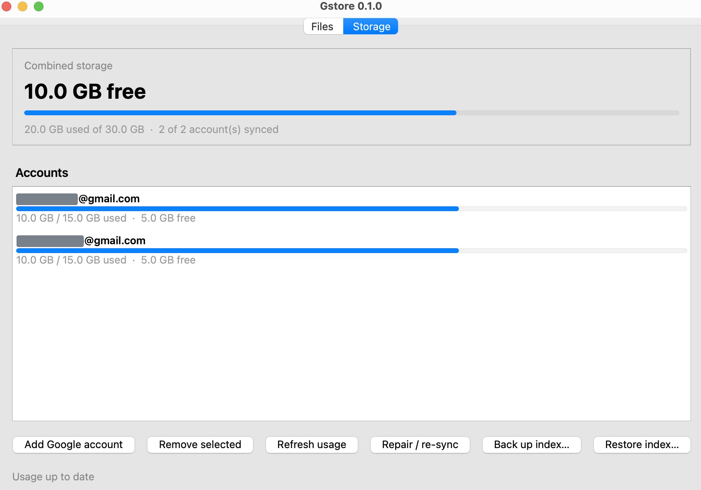

# Gstore

[](https://github.com/Parthivsurya/Gstorage/releases/latest)
[](https://github.com/Parthivsurya/Gstorage/actions/workflows/release.yml)
[](https://www.python.org/downloads/)
[](#install)
[](LICENSE)

**Pool the free storage of several Google accounts into one drive.**

Every Google account comes with 15 GB free. Three accounts is 45 GB — but as
three disconnected silos: you have to remember which account holds what, and no
single file list spans them. Gstore puts one folder tree over all of them, picks
which account each upload should land on, and keeps track of where everything
went.



*A 20 GB file — too big for either account on its own — split into 409 chunks
and coming back. Several chunks are fetched at once; one at a time was roughly
four times slower.*

It is a desktop app, and it is **local-only**. File bytes travel straight
between your machine and Google's servers. There is no Gstore server, no Gstore
account, and nothing to sign up for — see the [privacy policy](PRIVACY.md).
That holds for [sharing](#sharing-a-file-by-link) too: a shared file goes
straight from Google to whoever holds the link, and the link itself never
reaches a server of ours.

```
┌───────────────────── your machine ─────────────────────┐
│                                                        │
│  Gstore — a Qt desktop app                             │
│    ├─ SQLite index ..... the one virtual folder tree   │
│    └─ OS keychain ...... master key for saved tokens   │
│                                                        │
└─────────┬─────────────────┬─────────────────┬──────────┘
          │                 │                 │
      account A         account B         account C
       (15 GB)           (15 GB)           (15 GB)
          │                 │                 │
══════════╧═════════════════╧═════════════════╧═══════════
         Google Drive API — direct, no middleman
```

## Install

| Platform | Download |
| --- | --- |
| macOS (Apple silicon) | [Gstore-macos-arm64.dmg](https://github.com/Parthivsurya/Gstorage/releases/latest/download/Gstore-macos-arm64.dmg) |
| Windows 64-bit | [Gstore-windows-x64.zip](https://github.com/Parthivsurya/Gstorage/releases/latest/download/Gstore-windows-x64.zip) |
| Linux x86_64 | [Gstore-linux-x64.tar.gz](https://github.com/Parthivsurya/Gstorage/releases/latest/download/Gstore-linux-x64.tar.gz) |

Those links always point at the newest release; what changed in each is in the
[release notes](https://gstore.iampkb.dev/release-notes/).

**The builds are not code-signed, so your OS will warn you the first time.**
On macOS, open System Settings → Privacy & Security and choose **Open Anyway**.
On Windows, SmartScreen says "Windows protected your PC" — choose **More info**
→ **Run anyway**; unzip first and keep `Gstore.exe` next to its files. On Linux
extract the tarball and run `./Gstore/Gstore`, keeping it beside its files.

You only do that once. Gstore updates itself after that, and an update it
installs raises no warning at all.

macOS asks for your login keychain password once, so Gstore can store its
encryption key. Choose **Always Allow**.

### From source

Requires **Python 3.11+**. Qt arrives via `PySide6` as a normal dependency.

```bash
git clone https://github.com/Parthivsurya/Gstorage.git
cd Gstorage
python3 -m venv .venv
source .venv/bin/activate        # Windows: .venv\Scripts\activate
pip install -e .
gstore                           # or: python -m gstore
```

> **A source checkout cannot sign in on its own.** The OAuth client that
> identifies Gstore to Google is deliberately not in this repository, so the
> step above gives you an app that raises `ClientSecretsNotFound` the moment you
> try to add an account. Supply your own Google Cloud Desktop client first —
> see [Google Cloud project setup](#google-cloud-project-setup).
> The downloadable builds above already have one baked in.

## Adding accounts

Launch Gstore, open the **Storage** tab and click **Add Google account** once
per account. Your browser opens, you consent with "Sign in with Google", and the
account joins the pool. Repeat for every account you want to pool.

You do **not** need a Google Cloud project to *use* a downloaded build — it
ships its own OAuth client, so there is no console setup and no JSON to
download.



*Two 15 GB accounts reading as one 30 GB pool, holding the 20 GB file between
them. Account names are masked in this screenshot, not in the app.*

If an account's access is later revoked or expires, Gstore marks that row
"needs re-link" and keeps its files listed rather than hiding them. Clicking
**Add Google account** and signing in as that account again restores access.

## What it does

**One drive from several accounts.** Link as many Google accounts as you like
and Gstore shows a single folder tree across all of them, with one combined
total. It remembers which account every file went to, so you never have to.

**Files bigger than any one account.** A file that fits goes to whichever
account has the most room. One that fits nowhere is split into 50 MB pieces
spread across several accounts and reassembled on the way back, verified
against its checksum. Transfers run several at a time and survive being
interrupted — closing the app mid-upload is a pause, not a loss.

**Folders, both directions.** Upload a folder and its structure is kept, its
files spread across whichever accounts have room; download one and it is
rebuilt from wherever the pieces live. Dependency directories like
`node_modules` are left out, with the count shown before anything starts.
Stopping and starting again picks up where it left off rather than beginning
over.

**Share a file with a link.** Whoever you send it to needs no Gstore, no
Google account and no sign-in — the file comes straight from Google to them.
Stop sharing and the link stops working.

**Your Drive stays tidy.** Everything Gstore writes lives in a single `Gstore`
folder on each account rather than loose in My Drive. **Tidy up my Drive** on
the Storage tab moves files from older versions into it, without re-uploading
anything or breaking links you have already sent.

**It updates itself.** Every release is signed, and Gstore refuses an update
that does not match its key. Press Download and it fetches the right build for
your machine, checks it, replaces itself and restarts.

**It repairs itself.** **Repair / re-sync** reconciles the index against what
is actually in each Drive: files deleted elsewhere are dropped, files it finds
that the index lost are recovered, and leftovers from abandoned uploads are
cleaned up.

## What Gstore can see

Gstore asks for the narrowest permission that makes the feature you are using
work.

| Scope | When | What it allows |
| --- | --- | --- |
| `drive.file` | Always | Only the files Gstore itself created. Enough for pooled storage totals, uploads, downloads, and managing Gstore's own files. Not a restricted scope. |
| `drive` | Opt-in only | Full Drive access, needed for the combined **Scan Drive now** view over files Gstore did not create, and for trashing one of them. |

Google restricts the full `drive` scope, and asking for it would put an "app
not verified" screen in front of everyone, so Gstore does not. Turn it on with
the `GSTORE_FULL_DRIVE` environment variable or a `full_drive.enabled` file in
the app-data directory.

Scope changes only affect accounts linked *afterwards*. An existing token keeps
whatever it was granted until you re-link that account — **Add Google
account** again, signing in as the same account — so until then an older
account still shows only its Gstore files in a scan and cannot trash
anything else.

Apart from updates, Gstore makes **no network requests to anywhere but
Google**. At startup it asks GitHub whether a newer version exists — an
anonymous `GET` carrying no account data, no file names and no identifier.
Nothing is downloaded until you press Download, and nothing is installed until
you say so. Switch the whole thing off with `GSTORE_NO_UPDATE_CHECK=1`, or an
`update_check.disabled` file in the app-data directory, and Gstore contacts
nothing but Google.

For what is stored and what is not, see [PRIVACY.md](PRIVACY.md).

## Development

```bash
pip install -e ".[test]"
python -m pytest -q
```

Long Drive operations each run on their own `QThread` worker so the UI never
blocks; `src/gstore/ui/*_worker.py` is the pattern to copy when adding one.

## Maintainers

### Bundling the OAuth client

The shipped client lives at `src/gstore/auth/client_config.json`. It is a
Desktop (PKCE) client with no confidential secret to protect, but the file is
**gitignored** so real credentials are never committed. Inject it at build time:

```bash
cp /path/to/client_secret.json src/gstore/auth/client_config.json
```

CI does this from the `GSTORE_CLIENT_CONFIG` repository secret. Without it the
built app raises `ClientSecretsNotFound` and nobody can sign in.

To point Gstore at a different project without touching the package:

```bash
export GSTORE_CLIENT_SECRETS=/path/to/client_secret.json
# or drop it at the app-data path:
cp /path/to/client_secret.json \
   "$HOME/Library/Application Support/Gstore/client_secret.json"
```

Resolution order: `GSTORE_CLIENT_SECRETS` → app-data `client_secret.json` →
bundled client.

### Google Cloud project setup

1. Create a project at <https://console.cloud.google.com> and enable the
   **Google Drive API**.
2. Configure the **OAuth consent screen** (External). Publish to **In
   production** so refresh tokens don't expire and there is no test-user cap.
3. Create an **OAuth client ID** of type **Desktop app** and download its JSON.

### Releasing

PyInstaller bundles the host's Python and Qt and cannot cross-compile, so every
platform is built on its own runner. Push a version tag:

```bash
git tag v0.0.6 && git push origin v0.0.6
```

`.github/workflows/release.yml` then builds each platform, runs the tests, and
publishes a GitHub Release with version-less asset names, so the
`releases/latest/download/...` links above never break.

### Publishing docs

This branch is served by GitHub Pages from the repository root, so Jekyll turns
**every tracked `.md` into a public page**. `_config.yml` carries an explicit
`exclude:` list and only this README and `PRIVACY.md` are public. Any new
Markdown file is public unless you add it there.

## Status

Current version **0.1.8**, for macOS, Windows and Linux. A 20 GB file has been
through it end to end — up through four interruptions, back through another,
byte-for-byte identical — and a 282-file folder has made the same round trip.

Known gaps, honestly:

- **Not code-signed or notarized**, so every platform warns on a first install.
  Updates Gstore installs itself do not.
- **The Linux build has never been launched on a real Linux desktop.** It
  compiles and its tests pass headless in CI; nobody has run the GUI.
- **A chunk needs one account with room for the whole 50 MB chunk.** Pooled
  space spread very thinly will not place a file even when the total would fit.
- **A shared download cannot be resumed.** If the connection drops, the
  recipient starts that file again.
- **Scan Drive needs the opt-in flag**, and because the full-Drive permission
  is one Google restricts, enabling it shows an "app not verified" screen.
- Long filenames clip in Grid and Gallery view.

Still ahead: code signing, and a FUSE mount exposing the pool as a real
filesystem.

## Licence

Copyright © 2026 PKB. **All rights reserved** — see [LICENSE](LICENSE).

The source is public so it can be read and audited, which matters for an app
that asks for access to your Google Drive. That is the only thing publishing
it grants. It is **not** open source: no permission is given to use, copy,
modify, redistribute or sell Gstore or any part of it. If you want to do any
of those, ask.

The build instructions above are provided for the copyright holder and for
anyone who has been granted permission. Third-party dependencies (Qt/PySide6,
the Google client libraries, and the rest) keep their own separate licences.
