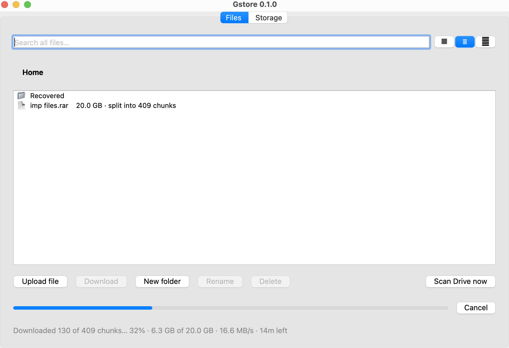
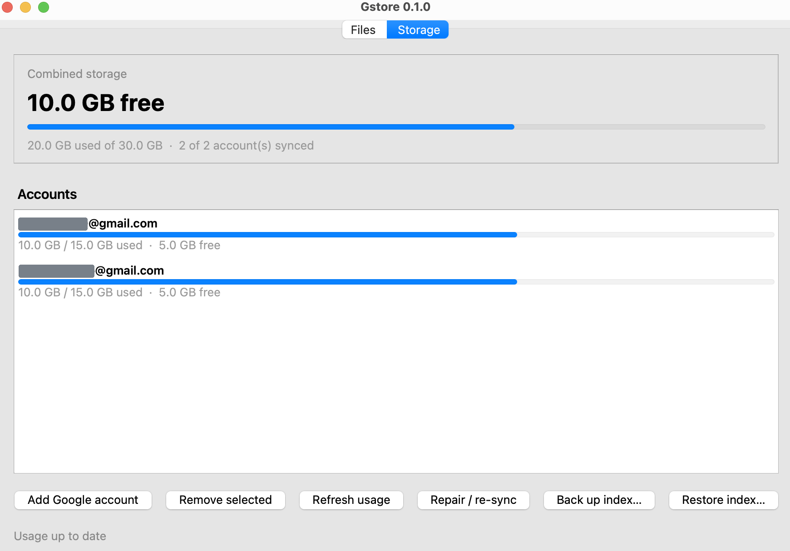
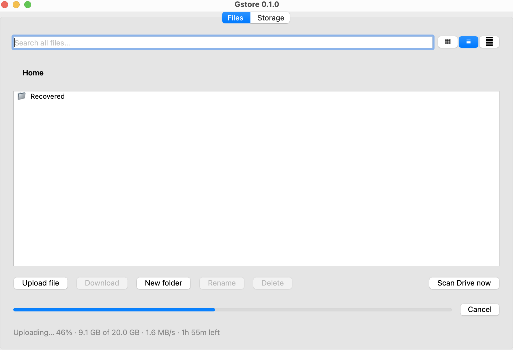

# Gstore

[](https://github.com/Parthivsurya/Gstorage/releases/latest)
[](https://github.com/Parthivsurya/Gstorage/actions/workflows/release.yml)
[](https://www.python.org/downloads/)
[](#install)
[](LICENSE)

**Pool the free storage of several Google accounts into one drive.**

Every Google account comes with 15 GB free. Three accounts is 45 GB — but as
three disconnected silos: you have to remember which account holds what, and no
single file list spans them. Gstore puts one folder tree over all of them, picks
which account each upload should land on, and keeps track of where everything
went.



*A 20 GB file — too big for either account on its own — split into 409 chunks
and coming back. Several chunks are fetched at once; one at a time was roughly
four times slower.*

It is a desktop app, and it is **local-only**. File bytes travel straight
between your machine and Google's servers. There is no Gstore server, no Gstore
account, and nothing to sign up for — see the [privacy policy](PRIVACY.md).
That holds for [sharing](#sharing-a-file-by-link) too: a shared file goes
straight from Google to whoever holds the link, and the link itself never
reaches a server of ours.

```
┌───────────────────── your machine ─────────────────────┐
│                                                        │
│  Gstore — a Qt desktop app                             │
│    ├─ SQLite index ..... the one virtual folder tree   │
│    └─ OS keychain ...... master key for saved tokens   │
│                                                        │
└─────────┬─────────────────┬─────────────────┬──────────┘
          │                 │                 │
      account A         account B         account C
       (15 GB)           (15 GB)           (15 GB)
          │                 │                 │
══════════╧═════════════════╧═════════════════╧═══════════
         Google Drive API — direct, no middleman
```

## Install

### Download a build

| Platform | Download |
| --- | --- |
| macOS (Apple Silicon) | [Gstore-macos-arm64.dmg](https://github.com/Parthivsurya/Gstorage/releases/latest/download/Gstore-macos-arm64.dmg) |
| macOS (Intel) | [Gstore-macos-intel.dmg](https://github.com/Parthivsurya/Gstorage/releases/latest/download/Gstore-macos-intel.dmg) |
| Windows 64-bit | [Gstore-windows-x64.zip](https://github.com/Parthivsurya/Gstorage/releases/latest/download/Gstore-windows-x64.zip) |
| Linux x86_64 | [Gstore-linux-x64.tar.gz](https://github.com/Parthivsurya/Gstorage/releases/latest/download/Gstore-linux-x64.tar.gz) |

Those links always resolve to the newest release. What changed in each version is written up in the
[release notes](https://gstore.iampkb.dev/release-notes/). The Intel macOS
build comes from a best-effort CI job and may be missing from a given release;
the Apple Silicon and Intel builds are not interchangeable.

**These builds are not code-signed**, so the OS will warn you on first launch:

- **macOS** — the app is blocked the first time. Open System Settings → Privacy
  & Security, find the notice about Gstore, and choose **Open Anyway**.
- **Windows** — SmartScreen shows "Windows protected your PC". Choose **More
  info** → **Run anyway**. Unzip first and run `Gstore.exe` from the extracted
  folder, keeping it next to its files.
- **Linux** — no warning, but Qt needs a desktop session. Extract and run the
  binary, keeping it next to its files:

  ```bash
  tar -xzf Gstore-linux-x64.tar.gz
  ./Gstore/Gstore
  ```

macOS asks for your login keychain password once, so Gstore can store its
encryption key. Choose **Always Allow** so it stops asking.

### From source

Requires **Python 3.11+**. Qt arrives via `PySide6` as a normal dependency.

```bash
git clone https://github.com/Parthivsurya/Gstorage.git
cd Gstorage
python3 -m venv .venv
source .venv/bin/activate        # Windows: .venv\Scripts\activate
pip install -e .
gstore                           # or: python -m gstore
```

> **A source checkout cannot sign in on its own.** The OAuth client that
> identifies Gstore to Google is deliberately not in this repository, so the
> step above gives you an app that raises `ClientSecretsNotFound` the moment you
> try to add an account. Supply your own Google Cloud Desktop client first —
> see [Google Cloud project setup](#google-cloud-project-setup).
> The downloadable builds above already have one baked in.

## Adding accounts

Launch Gstore, open the **Storage** tab and click **Add Google account** once
per account. Your browser opens, you consent with "Sign in with Google", and the
account joins the pool. Repeat for every account you want to pool.

You do **not** need a Google Cloud project to *use* a downloaded build — it
ships its own OAuth client, so there is no console setup and no JSON to
download.



*Two 15 GB accounts reading as one 30 GB pool, holding the 20 GB file between
them. Account names are masked in this screenshot, not in the app.*

If an account's access is later revoked or expires, Gstore marks that row
"needs re-link" and keeps its files listed rather than hiding them. Clicking
**Add Google account** and signing in as that account again restores access.

## How it works

### One index, many drives

A local SQLite database is the single source of truth for what you see. It
holds a self-referential folder tree (`parent_id`, `NULL` at the virtual root)
plus one row per file recording its name, size, MD5, and which account
physically holds it. The folder tree is purely Gstore's — it exists in the index
only, so a "folder" can contain files that live on three different Google
accounts.

The database is created on first launch under your OS app-data directory, next
to everything else Gstore writes:

| | |
| --- | --- |
| macOS | `~/Library/Application Support/Gstore/gstore.db` |
| Linux | `~/.local/share/Gstore/gstore.db` |
| Windows | `%LOCALAPPDATA%\Gstore\gstore.db` |

### Choosing where a file goes

On upload Gstore reads each account's last quota snapshot and picks
**most-free-first among the accounts the file actually fits in**. An account
with unlimited storage wins outright; accounts with no quota snapshot yet are
skipped.

Whole-file placement is the default on purpose: a file lives entirely on one
account, so one lost or locked account can never corrupt files held elsewhere,
and Drive's native preview keeps working.

When a file fits in *no* single account, Gstore falls back to splitting it into
fixed **50 MB chunks** spread across several accounts. Chunked files carry no
home account; their pieces are tracked individually and the whole-file checksum
is kept so reassembly can be verified end to end.

### Uploads and downloads




**Several chunks move at once.** A single connection to Google is held well
below what a modern link can carry — latency and per-connection limits, not
bandwidth — so one chunk at a time left most of the line idle. Measured on a
5G connection rated 80 Mb/s:

| Direction | One at a time | Concurrent | |
| --- | --- | --- | --- |
| Download | 0.87 MB/s | 3.78 MB/s | **4.3×** |
| Upload | 0.49 MB/s | 1.20 MB/s | **2.5×** |

Four streams by default — deliberately short of what the link can take, since
every stream spends Drive API quota and shares a per-user rate limit. Raise it
with `GSTORE_DOWNLOAD_STREAMS` and `GSTORE_UPLOAD_STREAMS` (max 16).

**An interrupted transfer resumes, in both directions.** Uploads record each
finished chunk against the local file's identity (path + size + mtime), so any
edit to the file invalidates the stale progress. Downloads accumulate into a
sibling `.gstore-part` file and record which chunks arrived; the destination
only appears once the whole-file checksum passes, so it never holds partial or
unverified data. Pick the same file or destination again and it continues.

**Cancelling is pausing.** What has already moved is kept, so a cancelled
transfer resumes exactly like an interrupted one. Quitting mid-transfer offers
the same, rather than losing the work.

Content MD5 is checked against Drive's own `md5Checksum` on the way up, and
each chunk is hashed as it streams on the way back down, with the reassembled
file verified against the original's checksum before it is put in place.

Every Drive API call goes through one retry wrapper that backs off
exponentially on `429`, `500`, `502`, `503`, `403 rateLimitExceeded` /
`userRateLimitExceeded` — and on transport failures, which is the common case:
a dropped link, a reset connection, DNS briefly vanishing. A blip slows a
transfer down instead of ending it.

### Sharing a file by link

**Share** on the Files tab turns a stored file into a link anyone can download
it with. The recipient needs Gstore, and nothing else — no Gstore account, no
Google account, no sign-in, and none of the sender's accounts linked.

That works because every piece is an ordinary Drive file Gstore created, so
`drive.file` is enough to mark it readable by anyone holding its id. The
recipient then fetches it over a plain HTTPS request with no token at all. No
restricted scope is involved on either side.

The link does not name the pieces. A 20 GB file is 409 of them, and listing
their ids costs about 26 KB — far past what anyone can paste into a chat. So
the list is itself uploaded to Drive as a small file, and the link points at
that:

```
https://gstore.iampkb.dev/s#<manifest-id>.<key>
                            └──────── fragment ────────┘
```

Two things follow from the shape of that URL:

- **Everything identifying sits after the `#`.** Browsers never send a fragment
  in a request, so the page that URL resolves to — a static page explaining how
  to open the link — never learns which file is being shared. There is no
  server in this feature at all.
- **The list is encrypted, with the key only in the link.** Reaching the
  manifest file without the link yields ciphertext, so the piece ids stay
  unknown. That protects the ids, not the bytes: anyone you send the link to
  can read the file and pass that ability on.

**Stop sharing** makes every piece private again and deletes the manifest, so
the link stops working — but, like any share link, it cannot recall a copy
someone already downloaded. Gstore records which files have live links so a
share can be withdrawn later; that record is the only thing that knows the
manifest's id once the link has been handed out.

Received files are verified the same way downloads are: each piece against its
own checksum as it streams, then the whole file against the sender's, before
the destination appears. That matters more here than elsewhere — an
unauthenticated Drive endpoint answers a withdrawn or rate-limited share with
an HTML page and a `200`, so "50 MB of HTML" is a real thing that can land
mid-file.

### Keeping the index honest

Because the index is a cache of someone else's state, it can drift: you might
delete a Gstore file from the Drive web UI directly. **Repair / re-sync** on the
Storage tab walks each linked account and reconciles both directions — pruning
index rows for files that no longer exist, and recovering Gstore files that
exist on Drive but went missing from the index.

Deleting a folder spans accounts, and partial failures are reported rather than
silently swallowed.

### Browsing

The **Files** tab renders the virtual tree with breadcrumb navigation, in three
view modes — **List** (detailed rows), **Grid** (wrapping icons), and
**Gallery** (large tiles that fill in with real Drive thumbnails, fetched on a
background thread). You can upload, download, rename, delete, and create
folders from here.

**Scan Drive now** is different: instead of reading the index, it queries every
linked account live and shows one combined listing of *all* their files,
including files Gstore never created. This needs the opt-in whole-Drive
permission described below. Deleting from a scan moves the file to Drive's
Trash, where it stays recoverable — it is not a permanent erase.

### Credentials

Google refresh tokens are serialised, **Fernet-encrypted**, and stored in the
local database. The master key is never on disk: it lives in your OS keychain
(Keychain on macOS, Credential Manager on Windows, Secret Service on Linux) via
`keyring`, fetched once per process. Access tokens refresh automatically.

## What Gstore can see

Gstore asks for the narrowest permission that makes the feature you are using
work.

| Scope | When | What it allows |
| --- | --- | --- |
| `drive.file` | Always | Only the files Gstore itself created. Enough for pooled storage totals, uploads, downloads, and managing Gstore's own files. Not a restricted scope. |
| `drive` | Opt-in only | Full Drive access, needed for the combined **Scan Drive now** view over files Gstore did not create, and for trashing one of them. |

The full `drive` scope is **restricted** by Google: it is granted only to a
verified app holding a current CASA security assessment. Requesting it from
every user would put an "app not verified" wall in front of everyone, so Gstore
does not ask for it by default. Enable it with the `GSTORE_FULL_DRIVE`
environment variable (development) or by creating a `full_drive.enabled` marker
file in the app-data directory.

Scope changes only affect accounts linked *afterwards*. An existing token keeps
whatever it was granted until you re-link that account — **Add Google
account** again, signing in as the same account — so until then an older
account still shows only its Gstore files in a scan and cannot trash
anything else.

Apart from one update check, Gstore makes **no network requests to anywhere
but Google**. At startup it asks GitHub's public releases endpoint whether a
newer version exists — an anonymous `GET` carrying no account data, no file
names and no identifier — and shows a notice if one does. Nothing is
downloaded or installed automatically. Switch it off with
`GSTORE_NO_UPDATE_CHECK=1`, or by creating `update_check.disabled` in the
app-data directory, and the app contacts nothing but Google.

For what is stored and what is not, see [PRIVACY.md](PRIVACY.md).

## Project layout

```
src/gstore/
  app.py              entry point — opens the DB, launches the window
  config.py           app-data paths, opt-in whole-Drive flag
  format.py           human-readable byte sizes
  auth/
    oauth.py          PKCE loopback sign-in, scope sets
    accounts.py       linked-account records
    keystore.py       Fernet master key, held in the OS keychain
  db/
    database.py       SQLite connection + schema bootstrap
    schema.sql        accounts, folders, files, uploads, chunks
  drive/
    placement.py      which account a file goes to; chunk planning
    upload.py         resumable upload
    download.py       download + checksum verify
    chunk_upload.py   split an oversized file across accounts
    chunk_download.py fetch the pieces back and reassemble
    browse.py         live multi-account listing ("Scan Drive now")
    delete.py         Drive-side delete / trash
    quota.py          about.get storage snapshots
    hashing.py        MD5 integrity checks
    rate_limit.py     exponential-backoff retry wrapper
    reconcile.py      index <-> Drive repair
  index/
    store.py          index reads and writes
    uploads.py        in-flight resumable upload sessions
    pending_chunks.py which chunks of a chunked upload already landed
    backup.py         index backup
  ui/
    main_window.py    Files / Storage tabs
    file_browser.py   virtual tree, List / Grid / Gallery
    storage_panel.py  pooled totals, Add Google account, Repair / re-sync
    account_row.py    one account's usage bar and re-link notice
    *_worker.py       one QThread worker per long Drive operation
tests/                pytest suite
packaging/            PyInstaller spec, icon and DMG builders
docs/                 historical implementation plan
```

## Development

```bash
pip install -e ".[test]"
python -m pytest -q
```

Long Drive operations each run on their own `QThread` worker so the UI never
blocks; `src/gstore/ui/*_worker.py` is the pattern to copy when adding one.

## Maintainers

### Bundling the OAuth client

The shipped client lives at `src/gstore/auth/client_config.json`. It is a
Desktop (PKCE) client with no confidential secret to protect, but the file is
**gitignored** so real credentials are never committed. Inject it at build time:

```bash
cp /path/to/client_secret.json src/gstore/auth/client_config.json
```

CI does this from the `GSTORE_CLIENT_CONFIG` repository secret. Without it the
built app raises `ClientSecretsNotFound` and nobody can sign in.

To point Gstore at a different project without touching the package:

```bash
export GSTORE_CLIENT_SECRETS=/path/to/client_secret.json
# or drop it at the app-data path:
cp /path/to/client_secret.json \
   "$HOME/Library/Application Support/Gstore/client_secret.json"
```

Resolution order: `GSTORE_CLIENT_SECRETS` → app-data `client_secret.json` →
bundled client.

### Google Cloud project setup

1. Create a project at <https://console.cloud.google.com> and enable the
   **Google Drive API**.
2. Configure the **OAuth consent screen** (External). Publish to **In
   production** so refresh tokens don't expire and there is no test-user cap.
3. Create an **OAuth client ID** of type **Desktop app** and download its JSON.

### Releasing

PyInstaller bundles the host's Python and Qt and cannot cross-compile, so every
platform is built on its own runner. Push a version tag:

```bash
git tag v0.0.6 && git push origin v0.0.6
```

`.github/workflows/release.yml` then builds each platform, runs the tests, and
publishes a GitHub Release with version-less asset names, so the
`releases/latest/download/...` links above never break.

### Publishing docs

This branch is served by GitHub Pages from the repository root, so Jekyll turns
**every tracked `.md` into a public page**. `_config.yml` carries an explicit
`exclude:` list and only this README and `PRIVACY.md` are public. Any new
Markdown file is public unless you add it there.

## Status

Current version **0.1.0**, built for macOS, Windows and Linux. See the
[release notes](https://gstore.iampkb.dev/release-notes/) for what changed.

Everything the app is for works and has been exercised on a real 20 GB file:
multi-account sign-in, pooled totals, the unified folder tree, smart placement,
chunking across accounts, concurrent resumable transfers in both directions,
deletes spanning accounts, index repair, and the live combined Drive scan. That
file went up through four interruptions, came back through another, and
arrived byte-for-byte identical.

Known gaps, honestly:

- **Not code-signed or notarized**, so every platform warns on first launch.
- **The Linux build has never been launched on a real Linux desktop.** It
  compiles and its tests pass headless in CI; nobody has run the GUI.
- **A chunk needs one account with room for the whole chunk.** Pooled free
  space spread thinly across many accounts will not place a file even when the
  total would fit.
- **A fresh chunked upload reads the file twice** — once to checksum, once to
  send. Resumed uploads skip the first pass; fresh ones do not yet.
- **No folder upload**, and long filenames clip in Grid and Gallery view.

Still ahead:

- Code signing and notarization.
- Google OAuth verification + CASA assessment, to make the whole-Drive scan
  available without the opt-in flag.
- A FUSE mount, exposing the pool as a real filesystem.

The original design document, including the reasoning behind the early
decisions and the parts that did not survive contact with reality, is kept at
[docs/implementation-plan.md](docs/implementation-plan.md).

## Licence

Copyright © 2026 PKB. **All rights reserved** — see [LICENSE](LICENSE).

The source is public so it can be read and audited, which matters for an app
that asks for access to your Google Drive. That is the only thing publishing
it grants. It is **not** open source: no permission is given to use, copy,
modify, redistribute or sell Gstore or any part of it. If you want to do any
of those, ask.

The build instructions above are provided for the copyright holder and for
anyone who has been granted permission. Third-party dependencies (Qt/PySide6,
the Google client libraries, and the rest) keep their own separate licences.
